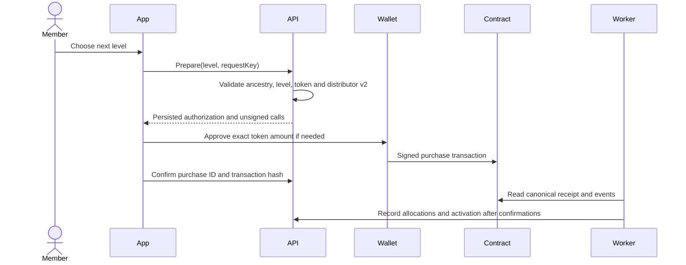

# UNXO payments and conditions

> Distribution version 3 supersedes the payment and tree rules reviewed below. See [current binary matrix, unilevel and automatic-upgrade rules](../matrix-payments.md). The older schedule below describes historical versions 1?2.


[Documentation index](../README.md) · [ภาษาไทย](../th/payments-and-conditions.md) · [System guide](system-guide.md) · [Operations](operations.md) · [API](api-reference.md)

Reviewed **27 October 2026**, source revision `3ffa828`. This document specifies implemented payment rules and identifies undefined policies. It does not create a refund policy, commercial guarantee or legally adopted terms of service.

## 1. Networks, assets and payment modes

The member wallet, referral purchases and supplied deployment workflow use **Polygon Amoy, chain ID 80002**. The deployment script creates `AmoyTestUSDT`: symbol **tUSDT**, six decimals, without monetary value. This is not real USDT, a dollar balance or a mainnet payment service. POL on Amoy pays network gas.

| Wallet mode | Referral payment mode | Who signs | What pays for a level |
| --- | --- | --- | --- |
| `external` (default) | Always `contract` | The connected wallet | Configured ERC-20 at the linked address |
| `embedded` | `contract` (default) | Server decrypts the member keystore after password confirmation | Configured ERC-20 at the embedded address |
| `embedded` | Explicit `ledger` | Password-authorized application operation | Existing internal USDT-labelled credits |

External mode ignores a request to use legacy ledger payment mode. Embedded credential login additionally requires `NUXT_PUBLIC_PASSWORD_LOGIN_ENABLED=true`. Missing contract configuration blocks contract purchases; the application does not silently spend ledger credits instead.

The generic Viem evidence library understands other supported EVM chains, but that does not enable mainnet payments in the member purchase/send flows. Historical credits, test tokens and gas are separate balances.

## 2. Fifteen levels and prices

For level `L`:

```text
price(L) = 10 × 2^(L − 1), for L = 1..15
cumulative cost through L = 10 × (2^L − 1)
```

Each level is purchased **in order and at its full price**, rather than the difference from the previous level. Level 1 activates the referral code. A fresh account starts at level 0. At level 15 there is no next purchase. Existing paid legacy levels can bootstrap the first contract purchase through the signed previous-level attestation; they do not generate retroactive payouts or token refunds.

| Level | Price in configured token units / legacy credits | Cumulative cost from level 0 |
| --- | ---: | ---: |
| 1 | 10 | 10 |
| 2 | 20 | 30 |
| 3 | 40 | 70 |
| 4 | 80 | 150 |
| 5 | 160 | 310 |
| 6 | 320 | 630 |
| 7 | 640 | 1,270 |
| 8 | 1,280 | 2,550 |
| 9 | 2,560 | 5,110 |
| 10 | 5,120 | 10,230 |
| 11 | 10,240 | 20,470 |
| 12 | 20,480 | 40,950 |
| 13 | 40,960 | 81,910 |
| 14 | 81,920 | 163,830 |
| 15 | 163,840 | 327,670 |

Gas is additional and excluded from this table. In the supplied deployment these are **tUSDT test units**, even where existing UI types/labels say USDT. No recurring renewal, timed level expiry or monthly qualification is enforced in the reviewed purchase logic.

## 3. Allocation of each purchase

For a purchase price `P`, the distributor emits nineteen allocations:

| Allocation | Recipient depth | Rate | Amount at P = 10 |
| --- | --- | ---: | ---: |
| Direct | Sponsor ancestor 1 | 50% | 5.00 |
| Direct | Sponsor ancestor 2 | 20% | 2.00 |
| Direct | Sponsor ancestor 3 | 10% | 1.00 |
| Bonus | Each ancestor depth 1–15 | 1% per depth; 15% total | 0.10 per depth; 1.50 total |
| Base platform fee | Current fee recipient | 5% | 0.50 |
| **Total** | | **100%** | **10.00** |

Direct and bonus shares overlap: with fifteen eligible ancestors, depths 1/2/3 receive 51%/21%/11%; depths 4–15 receive 1% each. These are purchase-based payouts, not periodic interest or salary. An invitation alone does not pay a commission.

### Who qualifies as an upline?

The API traverses the buyer's actual `sponsor_id` chain for up to fifteen ancestors. At quote preparation an eligible recipient must:

1. Have an activated referral code.
2. Have an active account.
3. Have a linked connected wallet in external mode, an embedded EVM wallet in embedded contract mode, or an internal ledger wallet in legacy ledger mode.

The reviewed code **does not require an upline to own the buyer's purchased level**, have two direct referrals, complete a binary matrix, meet turnover targets or purchase a monthly renewal. Eligibility is attested by the server and snapshotted in the signed purchase quote. The contract does not independently query PostgreSQL membership or suspension status.

### Missing recipients and highest-upline allocation

Let `H` be the greatest ancestor depth among eligible uplines, within the first fifteen:

- Each direct share remains at its original depth. Missing/ineligible direct shares go to the platform fee recipient.
- A bonus at a missing/ineligible depth **below H** also goes to the platform. Other ancestors do not move into that gap.
- Bonus depths **after H** are combined into the highest eligible upline at depth H, in addition to its own 1%.
- If no ancestor is eligible, all direct and bonus shares go to the platform recipient, together with its base 5%.

“Highest” means the furthest eligible ancestor in the chain, rather than the highest paid rank. A platform receipt can therefore exceed 5%. A recipient may receive several transfers from the same purchase.

### Worked examples for a 10-token purchase

| Eligible uplines | Result |
| --- | --- |
| All fifteen | Depth 1: 5.10; depth 2: 2.10; depth 3: 1.10; depths 4–15: 0.10 each; platform: 0.50 |
| Only depth 1 | Depth 1: 6.50 (5.00 direct + the full 1.50 bonus pool); platform: 3.50 |
| Depths 1–5 | Depth 1: 5.10; depth 2: 2.10; depth 3: 1.10; depth 4: 0.10; depth 5: 1.10; platform: 0.50 |
| Depths 1, 3, 4, 5; depth 2 ineligible | Depth 1: 5.10; depth 3: 1.10; depth 4: 0.10; depth 5: 1.10; platform: 2.60, including depth 2's direct 2.00 and bonus 0.10 |
| None | Platform: 10.00 |

Every example conserves the full purchase price. Rank projections depend on hypothetical qualifying purchases and are not guaranteed receipts. Matrix placement and display calculations do not add another payment or reinvestment charge.

## 4. Connected-wallet purchase lifecycle



1. Use the account's linked address on Amoy and select the next level.
2. The server checks the distributor, token, pause state, authority signer, previous level, recipients, balance and allowance. New purchases require `distributionVersion() == 2`.
3. A persisted EIP-712 authorization binds the unique purchase ID, buyer, next/previous levels, fifteen recipient slots, fee recipient, config nonce, deadline, chain and distributor.
4. External purchase quotes expire ten minutes after the latest chain timestamp used to prepare them. Embedded purchase quotes use one hour.
5. When allowance is insufficient, the wallet signs an exact-price approval. A nonzero insufficient allowance first requires a reset to zero. Existing sufficient allowance needs no new approval.
6. The wallet signs the purchase. The authority signature alone cannot spend buyer funds.
7. The contract collects the full price and pays the nineteen shares atomically. No purchase money is retained by the distributor after success.
8. The platform waits for a canonical receipt and the configured number of confirmations, **two by default**, and checks sender, target, calldata, completion event and all nineteen share events.
9. Only then does PostgreSQL record the paid level/commissions and activate a previously inactive member code. These commission records do not credit the legacy wallet again.

On-chain transfers happen in the purchase transaction; application recognition follows receipt confirmation. It is possible to see token transfers before the app updates its confirmed level.

### Status and retries

| State | Meaning | Appropriate next step |
| --- | --- | --- |
| `awaiting_signature` | Authorization exists; no tracked purchase hash yet | Complete wallet prompts, resume the same authorization, or wait for verified unused expiry |
| `pending` | Submitted/tracked, or evidence is still inconclusive | Refresh status and inspect the hash; retain the original operation ID |
| `confirmed` | Successful canonical receipt and required confirmations passed | Use the new level/code; review verified allocations |
| `failed` | Reverted receipt, or an external quote was verified expired and unused | Review the reason; create a fresh intended attempt if appropriate |

`requestKey` is a UUID for one intended operation. Reuse it on transport retries. Purchase uniqueness, next-level enforcement, one pending purchase per account and signed IDs protect against duplicate purchases. Do not use a new key just because an RPC call timed out.

The background worker runs every fifteen seconds. It reconciles pending receipts and can locate a purchase replacement by its signed purchase ID, even if the browser closed before submitting the hash. An unused external quote is released only after expiry is confirmed on-chain; browser time alone does not release it. Embedded mode persists signed transaction bytes before broadcasting and retries those same bytes after restart.

Purchase/send/admin writes share wallet-operation coordination. Pending purchases freeze sponsor changes. Unavailable RPC responses do not prove failure. Deep chain reorganizations beyond the chosen confirmation policy require operator reconciliation; do not change mode, token or distributor while operations remain unresolved.

## 5. Gas, token precision and failure behavior

- Purchase preparation does not check native POL balance or require a client gas quote. **Actual approvals and purchases still require POL gas** and wallet approval. A missing precheck does not make a transaction free.
- Purchase calls use an 800,000 gas limit and approvals 60,000 each. Embedded signed batches buffer the network gas-price cap by 15%. This is a transaction gas cap, not an additional token commission rate.
- Embedded admin fee changes keep gas-budget checks; `NUXT_REFERRAL_MIN_GAS_BALANCE` defaults to 0.003 POL as a minimum displayed administrative budget. External wallets review actual gas themselves.
- The distributor supports ERC-20 precision from six through eighteen decimals. Internal accounting is in integer millionths; the configured price splits exactly at that precision.
- Tokens with transfer fees, short delivery or incompatible balance changes are rejected. If any purchase payout fails, the entire purchase, token movements and contract level update revert. Previously completed approvals and gas charges are separate transactions and can remain.
- There is no automatic contract refund, cancellation of a confirmed purchase or arbitrary owner withdrawal function. Contracts are not upgradeable. The owner can pause purchases, change recipient/signer and transfer ownership, but cannot change the hardcoded prices or percentages through these controls.

## 6. Sending POL or tokens

The Send action transfers native POL or the configured ERC-20 on Amoy. It does not require referral activation, a distributor or the quote-authority key. It does not modify internal credits.

Connected mode prepares an unsigned intent, then the wallet signs and broadcasts it. The server tracks a hash only after checking the expected sender, destination, calldata, value, chain and any specified nonce. Token settlement additionally verifies the expected Transfer event and receipt.

Amounts are positive decimal strings within the asset's actual precision, rather than the legacy ledger minimum of 0.01. Invalid/zero recipients, self-transfers and sending to the configured token address are rejected. Send preparation checks token balance and enough POL for gas, including the sent amount for a native transfer.

The shared send planner uses a five-minute plan and estimates a maximum gas budget. Embedded mode enforces its reviewed quote/hash, expiry and password before signing; external mode returns an unsigned wallet intent and the wallet performs the final review. Do not assume an unsigned external intent is automatically canceled by a five-minute timer; its persisted operation has no comparable expiry-release worker.

Recent operations retain up to twenty entries. Public hashes awaiting acknowledgment are retained in browser storage; reopening the same browser can retry tracking. Automatic replacement discovery is implemented for purchases, not general sends. Preserve a send's original and replacement hashes for investigation. A reverted send can charge gas; a dropped/replaced transaction or unavailable RPC may remain pending rather than trigger another payment.

## 7. Legacy funding, transfers and settlement

These compatibility features are not the current member funding interface. Deposit requests and internal transfers are blocked in external mode. Restoring embedded/ledger operation is an operator configuration decision.

### Funding request

1. An authenticated embedded-mode member submits `{ amount, requestKey }`, while `fundingOpen` is true.
2. The API creates a `pending` deposit record. **Available balance does not increase.** There is no automatic bank/card or token settlement in this route.
3. An authenticated administrator checks actual receipt outside this API and submits `decision: approved`, `verified: true` and a unique settlement reference of 6–160 characters. A note can contain up to 500 characters.
4. Credit, completed transaction status, review record and audit entry commit atomically. The reference is unique without regard to case. An identical review retry is idempotent; a conflicting review is rejected.
5. Rejection requires a reason of at least three characters and creates no credit. Displayed status is `rejected` via the review; the underlying ledger transaction can still hold `pending`.

Funding requests and legacy transfers accept 0.01–999,999,999 USDT-labelled credits, up to six decimal places. The input is a decimal string. An `LW-...` ledger ID is not a blockchain address and must not receive tokens.

### Internal transfers

The sender provides their password, recipient numeric member ID, amount and request key. The recipient must be active and different from the sender; the sender needs sufficient available credit. Ordered wallet locks and one transaction conserve balances, create matching debit/credit records and prevent duplicate retries. This is not an on-chain token transfer.

### Legacy level purchases

Explicit embedded + ledger mode debits existing credits and allocates the same percentage schedule and trailing-bonus rule. Eligible uplines receive completed internal commission credits. Platform/base/missing-recipient shares become `payable` records at the snapshotted fee address: **they have not been transferred on-chain**.

`GET /api/admin/referral-accounting` groups those legacy payables by address. The project has no automatic payout executor or settlement endpoint for those platform payables. Historical paid records are not redistributed retroactively. Changing the legacy fee address affects future purchases only; an empty fee address blocks new ledger purchases.

## 8. Operational controls and their scope

| Control | Enforced effect |
| --- | --- |
| `registrationOpen=false` | Prevents new accounts; existing active accounts can still sign in |
| `fundingOpen=false` | Prevents new legacy deposit requests; not a pause switch for contract purchases or wallet sends |
| Suspend member | Revokes sessions; blocks app use and eligibility in newly prepared quotes; does not freeze blockchain funds |
| Contract pause | Stops contract purchase execution; does not pause ordinary token sends or automatically remove existing allowance |
| Change on-chain fee recipient/signer | Increments `configNonce`, invalidating old purchase quotes; percentages remain fixed |
| Change ordinary platform settings | Cannot bypass on-chain ownership or update the chain recipient in contract mode |

The owner can invoke pause/signer/ownership functions on-chain; the current admin UI focuses on fee-recipient changes. Already issued quotes snapshot recipients. A later eligibility change does not rewrite them; a configuration change or expiry can invalidate them.

## 9. Policies not defined by this project

No implemented policy establishes a real-money redemption rate, cash withdrawal fee, refund entitlement/window, cancellation process, commercial service-level guarantee, guaranteed return, country eligibility, KYC rules or tax treatment. These are operator decisions if a real commercial service is intended. This document deliberately assigns no invented values or promises to them.

There is no daily/monthly payout scheduler: qualifying contract commissions transfer with the purchase transaction. There is no implemented minimum commission withdrawal, because those on-chain commissions are already in recipients' wallets. A manual Send is a normal blockchain transfer, not a fiat withdrawal. Legacy payables still need a separate settlement process.

## 10. Code references

- [Prices, shares and highest-upline selection](../../shared/compensation.ts)
- [Distributor rules and owner controls](../../contracts/ReferralDistributor.sol), [test token and faucet](../../contracts/AmoyTestUSDT.sol)
- [External eligibility/authorization](../../server/utils/external-wallet.ts), [receipt verification](../../server/lib/referral-chain.ts), [accounting and recovery](../../server/utils/referral-chain.ts)
- [Send rules](../../server/lib/evm-send.ts), [worker](../../server/plugins/referral-reconciliation.ts)
- [Legacy level purchase](../../server/utils/compensation.ts), [funding request](../../server/api/wallet/deposit.post.ts), [internal transfer](../../server/api/wallet/transfer.post.ts), [admin review](../../server/api/admin/payments/[id].post.ts)
