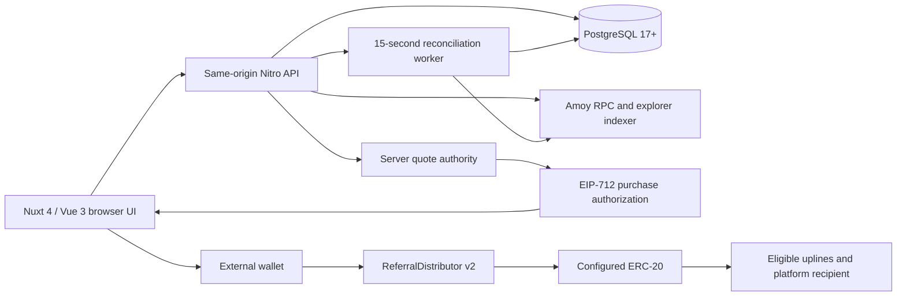

# UNXO system guide

> Distribution version 3 supersedes the payment and tree rules reviewed below. See [current binary matrix, unilevel and automatic-upgrade rules](../matrix-payments.md). The older schedule below describes historical versions 1?2.

[Documentation index](../README.md) · [ภาษาไทย](../th/system-guide.md) · [Payments and conditions](payments-and-conditions.md) · [Operations](operations.md) · [API](api-reference.md)

Source review: **27 October 2026**, revision `3ffa828`. This guide covers the repository implementation. Live balances, contract addresses, operational settings and deployment health were not audited.

## 1. Purpose and scope

UNXO is a referral workspace with member accounts, a sponsor network, fifteen paid levels, EVM wallets, automatic referral distributions, public activity reporting and an administrator workspace. It supports Thai and English and light/dark appearance.

The default payment workflow uses a connected external wallet on **Polygon Amoy testnet (80002)**. The supplied deployment creates **UNXO Test USDT (`tUSDT`)**, a test token without monetary value. UI labels or historical ledger amounts called “USDT” do not establish a connection to real USDT, dollars or a cash redemption service.

There are three separate kinds of money-related data:

| Data | Source of truth | Meaning |
| --- | --- | --- |
| POL and configured ERC-20 balances | Blockchain RPC | Assets at the account's current EVM address |
| Confirmed contract commissions | Verified receipts plus PostgreSQL accounting | Tokens already distributed on-chain |
| Historical internal credits and payables | PostgreSQL ledger | Application accounting; not tokens at an EVM address |

Linking a wallet does not move old funds or convert credits. The [payment guide](payments-and-conditions.md) explains prices and recipient rules.

## 2. Architecture

The API authenticates users and determines sponsor ancestry and eligibility. Its quote authority attests those facts. The buyer's wallet signs and broadcasts transactions. The contract fixes prices and payout percentages and executes all purchase transfers atomically. A server worker verifies receipts before activating codes and recording commissions.

| Repository area | Responsibility |
| --- | --- |
| `app/pages`, `app/layouts`, `app/middleware` | Member/public/admin routing and presentation |
| `app/components` | Wallets, purchases, trees, explorers, forms and shared controls |
| `app/composables`, `app/plugins` | Session state, wallet providers, summaries, preferences and refresh |
| `shared` | Shared types, prices, payout math, referral IDs and tree layout |
| `server/api` | HTTP endpoints and access checks |
| `server/utils`, `server/lib` | Auth, ledger, DB, EVM, purchase verification and recovery |
| `server/plugins` | Startup migrations and background reconciliation |
| `database/migrations` | Ordered PostgreSQL schema/data changes |
| `contracts` | Distributor, Amoy test token and test fixtures |
| `scripts` | Local database, admin setup, contract tools and test runners |
| `tests` | Unit, integration, database, contract and browser checks |
| `i18n`, `app/assets/css`, `public`, `design` | Translations, styling, bundled artwork and design notes |

Runtime dependencies include Nuxt/Vue, PostgreSQL (`pg`), Ethers and Viem. Solidity compilation uses the local `solc` package and OpenZeppelin contracts. Node **24+** is required.

## 3. People and permissions

| Actor | Access and authority |
| --- | --- |
| Visitor | Public pages, sample workspace, search by member ID, recorded platform transactions and aggregate analytics |
| Active member | Own account, linked wallet, referrals, purchases and wallet sends; authorized private network branches |
| Administrator | Member ID/password admin login, user management, operational settings, reporting and legacy settlement APIs |
| Contract owner | On-chain fee recipient/signer changes, pause/unpause and two-step ownership transfer |
| Quote authority | Signs eligibility, ancestry and previous-level attestations; cannot sign the buyer's transaction |
| Fee recipient | Receives the base platform fee and shares redirected under the payout rules |

An administrator is not automatically the contract owner. In-app fee changes require an admin session **and** a linked wallet that owns the configured distributor. Owner and fee-recipient addresses may differ. Deployment credentials are separate from runtime quote authority credentials.

Suspension deletes sessions and blocks application access, sign-in and legacy transfers to that recipient. New purchase quotes exclude suspended uplines. Suspension does not freeze an external blockchain wallet or revoke a previously issued contract authorization by itself.

## 4. Pages and navigation

| Route | Behavior |
| --- | --- |
| `/` | Landing page, explanations and illustrative rank calculator |
| `/dashboard` | Member overview, recorded commissions, referral summary, EVM wallet and recent sends; sample content for visitors |
| `/referrals` (`/referral`) | Sponsor linking, code activation/next-level purchase, referral tree/list and CSV export |
| `/wallet` | Linked/embedded EVM wallet, balances, Send, details and indexed history |
| `/explorer` | Public recorded contract transactions and network exploration according to access |
| `/search?id=1` (`/tree`) | Public sponsor tree by numeric member ID |
| `/faq` | Platform FAQ |
| `/faq/ranks` | Fifteen prices, payout rates and projections |
| `/faq/analytics` (`/analytics`) | Aggregate account and confirmed contract activity |
| `/dashboard?view=settings` | Read-only member ID, language, theme, wallet link, invite, sponsor and session controls |
| `/admin/login` | Administrator credentials login |
| `/admin`, `/admin/dashboard` | Admin entry/overview, growth and audit activity |
| `/admin/users` | Search by member ID, filter, paginate, inspect and suspend/reactivate accounts |
| `/admin/explorer` | Platform transactions and administrator network exploration |
| `/admin/settings` | Registration/funding flags, support email, contract status and fee-recipient management |

`/admin/payments` and `/admin/payment` redirect to the admin dashboard; the old payment-review screen is absent from current navigation. Legacy settlement APIs remain. Old `/dashboard?view=wallet`, `ranks`, `rewards`, `faq`, `analytics` and `matrix` links redirect to the current destinations. `matrix` resolves to the overview.

## 5. Account lifecycle

### Default connected-wallet sign-in

1. Choose MetaMask, Rabby or Phantom through an injected provider/EIP-6963 discovery. Use an extension or the wallet's built-in browser; desktop-to-phone QR pairing is not implemented. Phantom needs testnet support enabled for Amoy.
2. The server issues a single-use **five-minute** message with origin, wallet address, chain ID, nonce and expiry.
3. The wallet signs the message; the server recovers the signer and consumes the challenge atomically.
4. A new wallet creates a member account, numeric member ID, linked address and zero-balance legacy ledger wallet. It has no usable account password and no newly generated embedded private key.
5. A valid active invite establishes the sponsor. New-account creation obeys `registrationOpen`.
6. The server establishes a session. Signing in is separate from ERC-20 approvals and purchases.

`NUXT_PUBLIC_APP_URL` must be the exact canonical application origin for production wallet login. EOA signatures are supported; EIP-1271 contract-wallet login is absent. Admins use `/admin/login` even after linking a wallet.

### Legacy accounts and linking

Member password login is hidden and rejected by default. Temporarily enabling `NUXT_PUBLIC_PASSWORD_LOGIN_ENABLED=true` allows an existing credential account to sign in and link an external wallet with a second signature. Linking preserves the account UUID, sponsor, activation, purchases and history.

One linked address belongs to one account, and public APIs cannot replace it with another address. After linking, an external-mode member uses wallet sign-in. Admin credential login remains available. Old embedded keys and credits stay in the database; linking does not migrate their assets.

Embedded registration requires both `walletMode=embedded` and password login enabled. The member chooses a 12–128 character password; the server atomically assigns a numeric member ID and creates the ledger and encrypted Amoy wallet. Existing credentials use the assigned member ID plus password. IDs cannot be changed by members or administrators; public responses expose no username. See the [identity migration](../member-id-update.md).

### Sessions and protection

- `loop_session` is an HttpOnly, SameSite=Strict cookie with a seven-day lifetime; HTTPS adds Secure. Only its SHA-256 hash is stored in PostgreSQL.
- Logout revokes the current session. Suspension revokes the account's sessions.
- POST/PUT/PATCH handlers require the exact same `Origin`; protected endpoints select ownership from the session.
- Authentication and financial writes have scope/IP-based rate limits in 15-minute windows. Responses use `Cache-Control: no-store`.
- Passwords use salted scrypt hashes. Password recovery, password changes and MFA are not implemented.

## 6. Referrals and trees

Every account receives a numeric `memberId`, starting from `1`. Its `referralCode` becomes that same number after activation; it is `null` beforehand. Internal UUIDs remain separate. Old `UNXO-XXXXXXXX` invites remain aliases; `LOOP-` prefixes normalize to `UNXO-`.

An invite in `?ref=` can prefill sign-in from any page. The latest valid-looking incoming code is remembered in the browser tab; the server still validates sponsor availability. A sponsor must be activated and active. A member without a sponsor can attach one later, without a linking charge. An established sponsor cannot be replaced; self-sponsorship and cycles are rejected. Pending purchases block sponsor changes.

Current public/member tree rendering follows **actual sponsor relationships**, ordered by registration time and ID. All direct referrals remain beneath their sponsor, including a third or later child. Two empty branches are a visual preview, rather than a limit of two direct referrals. Paths use sibling indices separated by `/`, such as `0/2/1`, for up to fifteen generations. Public tree requests allow `levels=1..15`, default `3`, clamped at the fifteenth generation.

The schema still contains `referral_placements` and binary-placement triggers from migration 0012. These are retained data; the current tree endpoint reads `users.sponsor_id`, and payment ancestry also follows the sponsor chain. A binary-looking diagram does not establish a separate binary payout engine.

Authenticated referral lists and private network explorers cover up to fifteen generations and return at most 500 members with a `truncated` flag. Direct-count totals are separate. The public tree exposes numeric IDs, parent links and paths; it excludes names, internal UUIDs, credentials, balances, wallet addresses and account status. It does not require activation or a session merely to search an existing member ID.

## 7. Wallet, reporting and interface behavior

The wallet card and profile share the account's selected EVM address and a balance snapshot for thirty seconds; manual refresh updates both. The main displayed balance recognizes USDT and configured Amoy tUSDT. Missing/unsupported token configuration and failed reads show an unavailable amount; the detailed balance API can read a configured ERC-20's actual symbol/decimals.

Wallet history merges indexed native and ERC-20 records, caps display at fifty and needs a private explorer API key with Amoy access. It may lag blockchain state. It is separate from the twenty recent application sends/operations and from internal ledger history. No indexer credentials means unavailable history rather than fabricated transactions.

Dashboard commissions combine completed ledger commissions and verified on-chain allocations. Chain commissions are not credited again to the internal wallet. Lifetime earnings differ from the current token balance after outgoing transfers. Public Explorer shows DB-recorded purchase and fee-update hashes for the configured distributor, with twelve rows per page. Transactions sent directly outside the application require a separate indexer to appear there.

Analytics reports all accounts, active non-admin members, confirmed buyers/purchases, volume, distributions, thirty Bangkok calendar days and all fifteen levels. Contract activity is filtered to the configured distributor. Admin contract status totals can span stored distributors; distinguish those totals when replacing contracts. Admin overview growth uses its own UTC daily report.

Thai is the initial UI locale, regardless of browser language. `loop_locale` preserves the selection without URL prefixes; Thai formatted dates use the Buddhist calendar. Dark is the initial theme; `loop-color-mode` remembers light/dark. Shared controls support keyboard navigation, modal focus restoration and reduced-motion preferences. Referral CSV and diagram SVG exports are browser downloads, rather than settlement evidence.

## 8. Implemented limits

Rank/matrix calculations are illustrations. The full 2/4/8 example gives `3.4 × price` across fourteen hypothetical purchases; fields such as `firstCycle = 0.8 × price` and `allocated = 0.2 × price` are display calculations. There is no implemented matrix recycling or automatic reinvestment engine behind those figures. Sample visitor members and “Qualified” labels do not prove actual paid eligibility.

The repository does not implement bank/card checkout, fiat cash-out, a credit-to-token redemption API, recurring subscriptions, KYC, tax reporting, refund processing, password recovery or wallet replacement. No expiry/renewal schedule for paid levels is enforced in the reviewed code. Conditions that need an operator policy are listed in the [payment guide](payments-and-conditions.md).

## 9. Code references

- [Runtime defaults](../../nuxt.config.ts), [package scripts/dependencies](../../package.json)
- [Member workspace](../../app/components/MemberWorkspace.vue), [public search](../../app/pages/search.vue)
- [Authentication](../../server/utils/auth.ts), [wallet verification](../../server/api/auth/wallet/verify.post.ts), [mode controls](../../server/utils/wallet-mode.ts)
- [Public tree](../../server/api/referrals/tree.get.ts), [sponsor linking](../../server/api/referrals/sponsor.post.ts)
- [Dashboard](../../server/api/dashboard.get.ts), [platform reporting](../../server/utils/platform-activity.ts), [projection math](../../shared/plan.ts)
