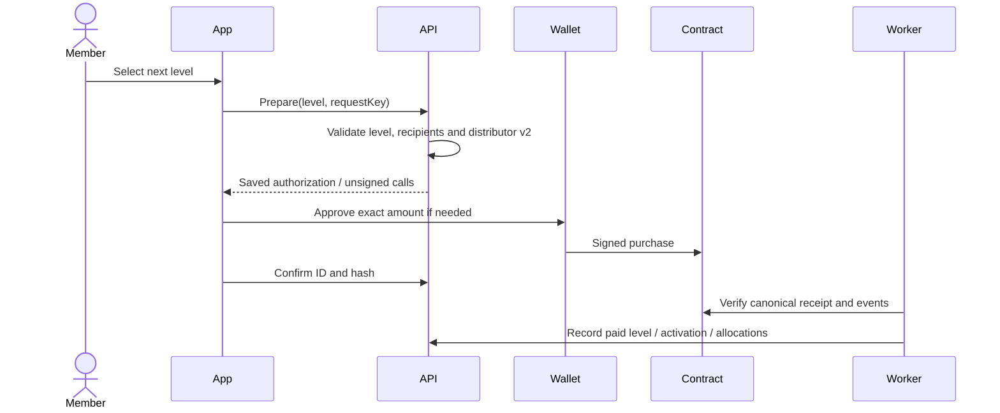

# ระบบการจ่ายเงินและเงื่อนไข UNXO

[สารบัญเอกสาร](../README.md) · [English](../en/payments-and-conditions.md) · [คู่มือระบบ](system-guide.md) · [คู่มือปฏิบัติการ](operations.md) · [API](api-reference.md)

ตรวจสอบวันที่ **27 ตุลาคม 2026** จาก revision `3ffa828` เอกสารนี้ระบุกติกาที่โค้ดทำงานอยู่และนโยบายที่ยังไม่ได้กำหนด ไม่ได้สร้างสิทธิ์คืนเงิน รับประกันรายได้ หรือข้อกำหนดการให้บริการที่ผ่านการประกาศใช้แล้ว

## 1. เครือข่าย สินทรัพย์ และโหมดชำระเงิน

กระเป๋าสมาชิก การซื้อระดับ และสคริปต์ deploy ใช้ **Polygon Amoy, chain ID 80002** สคริปต์สร้าง `AmoyTestUSDT` ชื่อย่อ **tUSDT** ทศนิยม 6 ตำแหน่ง เป็นโทเคนทดสอบที่ไม่มีมูลค่าเงินจริง ไม่ใช่ USDT จริง ยอดดอลลาร์ หรือระบบชำระเงิน mainnet ส่วน POL บน Amoy ใช้เป็นค่า gas

| โหมดกระเป๋า | โหมดจ่ายค่าระดับ | ผู้ลงนาม | สิ่งที่ใช้ชำระ |
| --- | --- | --- | --- |
| `external` ค่าเริ่มต้น | `contract` เสมอ | กระเป๋าที่เชื่อมต่อ | ERC-20 ที่ตั้งค่าไว้ในที่อยู่ที่ผูกบัญชี |
| `embedded` | `contract` ค่าเริ่มต้น | Server ถอดรหัส keystore หลังยืนยันรหัสผ่าน | ERC-20 ที่ตั้งค่าไว้ในที่อยู่ embedded |
| `embedded` | เปิด `ledger` อย่างชัดเจน | รายการภายในแอปที่ยืนยันรหัสผ่าน | เครดิต USDT ภายในเดิม |

External mode ไม่เปลี่ยนเป็น ledger แม้ตั้งค่า legacy payment mode ไว้ ส่วน embedded credential login ต้องเปิด `NUXT_PUBLIC_PASSWORD_LOGIN_ENABLED=true` ด้วย หากตั้งค่าสัญญาไม่ครบ ระบบจะปิดการซื้อผ่านสัญญา ไม่หักเครดิตภายในแทนโดยอัตโนมัติ

ไลบรารี Viem สำหรับตรวจหลักฐานรองรับ EVM อื่นบางเครือข่าย แต่ไม่ได้ทำให้หน้าซื้อ/ส่งของสมาชิกชำระบน mainnet ได้ เครดิตเดิม โทเคนทดสอบ และ gas เป็นคนละยอด

## 2. ราคา 15 ระดับ

สำหรับระดับ `L`:

```text
ราคา(L) = 10 × 2^(L − 1), เมื่อ L = 1..15
ราคาสะสมถึง L = 10 × (2^L − 1)
```

ต้องซื้อ **ตามลำดับและชำระเต็มราคาของระดับนั้น** ไม่ใช่ส่วนต่างจากระดับก่อน ระดับ 1 ใช้เปิดรหัสแนะนำ บัญชีใหม่เริ่มระดับ 0 และระดับ 15 ไม่มีระดับถัดไป สมาชิกที่เคยจ่ายในระบบเดิมอาจใช้ previous-level attestation เพื่อเริ่มซื้อบนสัญญาจากระดับเดิมได้ โดยไม่จ่ายค่าคอมมิชชันย้อนหลังและไม่คืนเป็นโทเคน

| ระดับ | ราคาในหน่วยโทเคนที่ตั้งค่า / เครดิตเดิม | สะสมจากระดับ 0 |
| --- | ---: | ---: |
| 1 | 10 | 10 |
| 2 | 20 | 30 |
| 3 | 40 | 70 |
| 4 | 80 | 150 |
| 5 | 160 | 310 |
| 6 | 320 | 630 |
| 7 | 640 | 1,270 |
| 8 | 1,280 | 2,550 |
| 9 | 2,560 | 5,110 |
| 10 | 5,120 | 10,230 |
| 11 | 10,240 | 20,470 |
| 12 | 20,480 | 40,950 |
| 13 | 40,960 | 81,910 |
| 14 | 81,920 | 163,830 |
| 15 | 163,840 | 327,670 |

ตารางยังไม่รวม gas ใน deployment ที่สคริปต์สร้าง ตัวเลขนี้คือ **tUSDT ทดสอบ** แม้ type/ข้อความเดิมบางส่วนเขียน USDT ไม่พบการเรียกเก็บต่ออายุ การหมดอายุตามเวลา หรือคุณสมบัติรายเดือนใน logic การซื้อที่ตรวจ

## 3. การแบ่งเงินแต่ละครั้ง

เมื่อราคาซื้อเท่ากับ `P` สัญญาจะมีรายการแบ่งจ่าย 19 ส่วน:

| ส่วนแบ่ง | ผู้รับตามระยะสายผู้แนะนำ | อัตรา | เมื่อ P = 10 |
| --- | --- | ---: | ---: |
| จ่ายตรง | ชั้น 1 | 50% | 5.00 |
| จ่ายตรง | ชั้น 2 | 20% | 2.00 |
| จ่ายตรง | ชั้น 3 | 10% | 1.00 |
| โบนัส | ทุกชั้น 1–15 | ชั้นละ 1% รวม 15% | ชั้นละ 0.10 รวม 1.50 |
| ส่วนแพลตฟอร์มพื้นฐาน | ผู้รับค่าธรรมเนียมปัจจุบัน | 5% | 0.50 |
| **รวม** | | **100%** | **10.00** |

ผู้รับส่วนจ่ายตรงรับโบนัสได้ด้วย หากมีผู้มีสิทธิ์ครบ 15 ชั้น ชั้น 1/2/3 จะรวมเป็น 51%/21%/11% และชั้น 4–15 ได้ชั้นละ 1% เป็นผลจากการซื้อแต่ละครั้ง ไม่ใช่ดอกเบี้ยหรือเงินเดือนตามรอบ การเชิญสมัครอย่างเดียวยังไม่เกิดค่าคอมมิชชัน

### เงื่อนไขผู้มีสิทธิ์รับเงิน

API ไล่ `sponsor_id` ของผู้ซื้อขึ้นไปไม่เกิน 15 คน ณ เวลาเตรียม quote ผู้รับต้อง:

1. เปิดใช้รหัสแนะนำแล้ว
2. มีสถานะบัญชี active
3. มีกระเป๋าภายนอกที่ผูกใน external mode, กระเป๋า EVM แบบ embedded ใน embedded contract mode หรือ ledger wallet ใน legacy ledger mode

โค้ดที่ตรวจ **ไม่ได้บังคับว่าผู้รับต้องซื้อระดับเท่าผู้ซื้อ** ไม่ได้กำหนดว่าต้องมีลูกตรงสองคน ผัง binary เต็ม ทำยอดขั้นต่ำ หรือต่ออายุรายเดือน Server เป็นผู้รับรองสิทธิ์และบันทึก snapshot ใน quote สัญญาไม่ได้อ่านฐานข้อมูลสมาชิกหรือสถานะระงับเอง

### กรณีไม่มีผู้รับและการรวมโบนัสให้ผู้แนะนำชั้นสูงสุด

ให้ `H` เป็นระยะของผู้แนะนำที่มีสิทธิ์ซึ่งอยู่ไกลจากผู้ซื้อมากที่สุด ภายใน 15 ชั้น:

- ส่วนจ่ายตรงยึดชั้นเดิมเสมอ ถ้าไม่มีหรือไม่มีสิทธิ์จะส่งให้ผู้รับค่าธรรมเนียมแพลตฟอร์ม
- โบนัสของชั้นที่ขาดสิทธิ์ **ก่อนถึง H** ส่งให้แพลตฟอร์ม ไม่เลื่อนคนอื่นมาแทนช่องนั้น
- โบนัสชั้น **ถัดจาก H จนถึงชั้น 15** รวมให้ผู้แนะนำที่ชั้น H เพิ่มจากโบนัส 1% ของตน
- ถ้าไม่มีผู้มีสิทธิ์เลย ส่วนจ่ายตรงและโบนัสทั้งหมดไปแพลตฟอร์ม พร้อมส่วนพื้นฐาน 5%

“ชั้นสูงสุด” ในที่นี้หมายถึงอยู่ไกลที่สุดในสายผู้แนะนำ ไม่ใช่คนที่ซื้อ rank สูงสุด แพลตฟอร์มจึงอาจรับเกิน 5% และคนเดียวอาจรับหลาย transfer จากการซื้อครั้งเดียว

### ตัวอย่างซื้อราคา 10 โทเคน

| ผู้มีสิทธิ์ | ผลการแบ่งจ่าย |
| --- | --- |
| ครบ 15 ชั้น | ชั้น 1: 5.10; ชั้น 2: 2.10; ชั้น 3: 1.10; ชั้น 4–15: ชั้นละ 0.10; แพลตฟอร์ม: 0.50 |
| มีเฉพาะชั้น 1 | ชั้น 1: 6.50 คือจ่ายตรง 5.00 + โบนัสทั้งกอง 1.50; แพลตฟอร์ม: 3.50 |
| มีชั้น 1–5 | ชั้น 1: 5.10; ชั้น 2: 2.10; ชั้น 3: 1.10; ชั้น 4: 0.10; ชั้น 5: 1.10; แพลตฟอร์ม: 0.50 |
| มีชั้น 1, 3, 4, 5 แต่ชั้น 2 ไม่มีสิทธิ์ | ชั้น 1: 5.10; ชั้น 3: 1.10; ชั้น 4: 0.10; ชั้น 5: 1.10; แพลตฟอร์ม: 2.60 ซึ่งรวมจ่ายตรงชั้น 2 จำนวน 2.00 และโบนัส 0.10 |
| ไม่มีเลย | แพลตฟอร์ม: 10.00 |

ทุกตัวอย่างรวมเท่าราคาซื้อทั้งหมด ตัวเลขประมาณการ rank ขึ้นกับการซื้อสมมติที่เข้าเงื่อนไข ไม่ใช่รายได้ที่รับประกัน การจัดผังและสูตรภาพประกอบไม่ได้สร้างยอดจ่ายเพิ่มหรือหักลงทุนซ้ำ

## 4. ขั้นตอนซื้อด้วยกระเป๋าภายนอก



1. ใช้กระเป๋าที่ผูกบัญชีบน Amoy และเลือกระดับถัดไป
2. Server ตรวจ distributor โทเคน pause ผู้ลงนาม quote ระดับเดิม ผู้รับ ยอดโทเคน และ allowance สัญญาที่รับซื้อใหม่ต้องมี `distributionVersion() == 2`
3. บันทึก EIP-712 authorization ที่ผูก purchase ID ผู้ซื้อ ระดับถัดไป/เดิม ผู้รับ 15 ช่อง ผู้รับค่าธรรมเนียม config nonce เวลาหมดอายุ chain และ distributor
4. Quote กระเป๋าภายนอกหมดอายุ 10 นาทีหลัง timestamp ของบล็อกล่าสุดที่ใช้เตรียม ส่วน embedded ใช้ 1 ชั่วโมง
5. ถ้า allowance ไม่พอให้ลงนาม approve เท่าราคาซื้อ ถ้า allowance เดิมไม่เป็นศูนย์แต่ยังไม่พอ ต้อง reset เป็นศูนย์ก่อน หากพออยู่แล้วไม่ต้อง approve ใหม่
6. กระเป๋าผู้ซื้อลงนาม purchase ลายเซ็น authority เพียงอย่างเดียวใช้เงินผู้ซื้อไม่ได้
7. สัญญารับเต็มราคาและโอนทั้ง 19 ส่วนในธุรกรรมเดียว หากสำเร็จจะไม่มีเงินค่าซื้อค้างใน distributor
8. แพลตฟอร์มรอ receipt จากบล็อก canonical และจำนวน confirmation ที่กำหนด **ค่าเริ่มต้น 2** พร้อมตรวจผู้ส่ง ปลายทาง calldata completion event และ share events ครบ 19 ส่วน
9. หลังผ่านแล้วจึงบันทึกระดับ/คอมมิชชันและเปิดรหัสสมาชิกที่ยังไม่เคยเปิด โดยไม่เพิ่มเครดิตเข้า ledger ซ้ำ

โทเคนย้ายในธุรกรรม purchase ส่วนการรับรองในแอปเกิดหลังตรวจ confirmation จึงอาจเห็นโทเคนเข้าแล้วก่อนหน้าจอแสดงระดับ confirmed

### สถานะและการลองใหม่

| สถานะ | ความหมาย | แนวทางดำเนินการ |
| --- | --- | --- |
| `awaiting_signature` | มี authorization แต่ยังไม่มี hash การซื้อที่ติดตาม | ทำขั้นตอนในกระเป๋าให้ครบ ใช้ authorization เดิม หรือรอหมดอายุที่ตรวจแล้วว่าไม่ถูกใช้ |
| `pending` | ส่ง/ติดตามแล้ว หรือหลักฐานยังไม่ชัด | รีเฟรชและดู hash เก็บ operation ID เดิมไว้ |
| `confirmed` | Receipt สำเร็จ อยู่ใน canonical chain และ confirmation ครบ | ใช้ระดับ/รหัสใหม่และตรวจรายการแบ่งจ่าย |
| `failed` | Receipt revert หรือ quote ภายนอกหมดอายุและตรวจแล้วว่าไม่ใช้ | ตรวจสาเหตุก่อนสร้างความพยายามใหม่ตามความเหมาะสม |

`requestKey` คือ UUID ต่อรายการที่ตั้งใจทำหนึ่งรายการ ต้องใช้ค่าเดิมเมื่อส่งซ้ำเพราะปัญหาเครือข่าย ระบบใช้ข้อจำกัดรายการซ้ำ การซื้อระดับถัดไป การมี purchase ค้างได้หนึ่งรายการ และ signed ID ป้องกันซื้อซ้ำ อย่าสร้าง key ใหม่เพียงเพราะ RPC timeout

Worker ทำงานทุก 15 วินาที ตรวจ receipt และค้นหา purchase ที่ถูกแทนที่ด้วย hash ใหม่ได้จาก signed purchase ID แม้ browser ปิดก่อนส่ง hash Quote ภายนอกที่ไม่ได้ใช้จะปล่อยรายการเมื่อพิสูจน์การหมดอายุบนเชนแล้ว เวลา browser อย่างเดียวไม่เพียงพอ ส่วน embedded บันทึก signed bytes ก่อน broadcast และส่ง bytes เดิมซ้ำหลัง restart ได้

การซื้อ/ส่ง/แก้ค่าธรรมเนียมใช้การควบคุม operation ของกระเป๋าร่วมกัน การซื้อค้างล็อกการเปลี่ยน sponsor RPC ติดต่อไม่ได้ไม่ใช่หลักฐานว่าล้มเหลว หากเกิด chain reorganization ลึกเกิน confirmation policy ต้องให้ผู้ดูแลตรวจและกระทบยอด อย่าเปลี่ยนโหมด โทเคน หรือ distributor ขณะยังมีรายการไม่จบ

## 5. Gas ความละเอียดโทเคน และกรณีล้มเหลว

- การเตรียม purchase ไม่ตรวจยอด POL และไม่บังคับ gas quote จาก client แต่ **approve และ purchase จริงยังต้องใช้ POL จ่าย gas** และต้องอนุมัติในกระเป๋า การไม่ตรวจล่วงหน้าไม่ได้ทำให้ธุรกรรมฟรี
- Purchase กำหนด gas limit 800,000 และ approval ครั้งละ 60,000 ใน embedded signed batch เพิ่ม buffer gas-price cap 15% ซึ่งเป็นเพดานค่า gas ไม่ใช่หักคอมมิชชันโทเคนเพิ่ม 15%
- การแก้ค่าธรรมเนียมแบบ embedded ยังตรวจงบ gas โดย `NUXT_REFERRAL_MIN_GAS_BALANCE` เริ่มต้น 0.003 POL เป็นงบแสดงขั้นต่ำสำหรับงานผู้ดูแล ส่วนกระเป๋าภายนอกให้ผู้ใช้ตรวจ gas จริงในกระเป๋า
- Distributor รองรับ ERC-20 ทศนิยม 6–18 ตำแหน่ง บัญชีภายในเก็บเป็นจำนวนเต็มหน่วยหนึ่งในล้าน และราคาทุกระดับแบ่งได้ลงตัวที่หน่วยนี้
- ปฏิเสธโทเคนหักค่าธรรมเนียมตอนโอน ส่งไม่ครบ หรือเปลี่ยนยอดไม่เข้ากัน หากจ่ายส่วนใดไม่สำเร็จ purchase การย้ายโทเคนและระดับบนสัญญาจะ revert ทั้งหมด แต่ approval ที่สำเร็จไปก่อนกับค่า gas เป็นคนละธุรกรรมและอาจยังคงอยู่
- ไม่มีฟังก์ชันคืนเงินอัตโนมัติ ยกเลิก purchase ที่ confirmed หรือให้ owner ถอนเงินใด ๆ ตามใจ สัญญาอัปเกรดในที่เดิมไม่ได้ Owner หยุดซื้อ เปลี่ยนผู้รับ/ผู้ลงนาม และโอนเจ้าของได้ แต่เปลี่ยนราคา/เปอร์เซ็นต์ที่ฝังในสัญญาด้วยคำสั่งเหล่านี้ไม่ได้

## 6. การส่ง POL หรือโทเคน

ปุ่ม Send ส่ง POL หรือ ERC-20 ที่ตั้งค่าไว้บน Amoy ไม่ต้องเปิดสิทธิ์แนะนำ ไม่ต้องมี distributor หรือ quote-authority key และไม่แก้เครดิตภายใน

Connected mode เตรียม unsigned intent แล้วกระเป๋าผู้ใช้ลงนามและส่ง Server รับติดตาม hash เมื่อผู้ส่ง ปลายทาง calldata มูลค่า chain และ nonce ที่ระบุไว้ตรงกับรายการ สำหรับโทเคนต้องตรวจ Transfer event ที่คาดหวังและ receipt เพิ่มด้วย

จำนวนเงินเป็น decimal string ที่มากกว่าศูนย์และไม่เกินทศนิยมจริงของสินทรัพย์ ไม่ได้ใช้ขั้นต่ำ ledger 0.01 ปฏิเสธที่อยู่ไม่ถูกต้อง/ศูนย์ การส่งให้ตนเอง และการส่งไปที่อยู่ token contract ที่ตั้งค่า การเตรียม Send ตรวจยอดโทเคนและ POL ให้พอ gas รวมยอดที่จะส่งในกรณี native

Send planner กลางสร้างแผนอายุ 5 นาทีและประมาณเพดาน gas Embedded บังคับ quote/hash ที่ตรวจทาน อายุ และรหัสผ่านก่อนลงนาม ส่วน external ส่ง unsigned intent ให้กระเป๋าตรวจขั้นสุดท้าย อย่าถือว่า external intent ที่ยังไม่ลงนามถูกยกเลิกอัตโนมัติเมื่อครบ 5 นาที เพราะ operation ที่บันทึกไม่มี worker ปล่อยรายการตามอายุแบบ purchase

รายการล่าสุดเก็บได้ 20 รายการ Hash ที่ยังรอ server รับทราบเก็บใน browser storage เปิด browser เดิมเพื่อส่งข้อมูลติดตามใหม่ได้ การค้นหา hash ทดแทนอัตโนมัติมีสำหรับ purchase แต่ยังไม่มีสำหรับ Send ทั่วไป ควรเก็บทั้ง hash เดิม/ใหม่ไว้ตรวจสอบ Send ที่ revert อาจเสีย gas ส่วนรายการหลุด ถูกแทน หรือ RPC ใช้ไม่ได้อาจคง pending แทนการส่งเงินอีกครั้ง

## 7. การเติมเครดิต โอนภายใน และตรวจรับชำระแบบเดิม

เป็นส่วนรองรับระบบเก่า ไม่ใช่หน้าฝากเงินของสมาชิกปัจจุบัน External mode ปิด deposit request และ internal transfer การเปิด embedded/ledger เป็นการตั้งค่าของผู้ดำเนินการ

### คำขอเติมเครดิต

1. สมาชิกที่ login ใน embedded ส่ง `{ amount, requestKey }` โดยต้องเปิด `fundingOpen`
2. API สร้าง deposit สถานะ `pending` **ยอด available ไม่เพิ่ม** Route นี้ไม่รับชำระธนาคาร/บัตรหรือ settle โทเคนอัตโนมัติ
3. ผู้ดูแลที่ login ตรวจว่าได้รับเงินนอก API นี้แล้ว จากนั้นส่ง `decision: approved`, `verified: true` และ reference ไม่ซ้ำยาว 6–160 ตัว Note ยาวไม่เกิน 500 ตัว
4. การเพิ่มเครดิต เปลี่ยนรายการเป็น completed บันทึก review และ audit commit พร้อมกัน Reference ไม่ซ้ำแม้ต่างตัวพิมพ์ หากส่ง review เดิมซ้ำไม่เพิ่มเงินซ้ำ แต่ถ้ารายละเอียดขัดกันจะปฏิเสธ
5. การ reject ต้องมีเหตุผลอย่างน้อย 3 ตัวและไม่เพิ่มเครดิต สถานะแสดงเป็น `rejected` ผ่าน review แม้ transaction ใน ledger อาจยังมีค่า `pending`

คำขอเติมและโอนภายในรับเครดิต USDT 0.01–999,999,999 ทศนิยมไม่เกิน 6 ตำแหน่ง โดย input เป็น string รหัส `LW-...` เป็น ledger ID ไม่ใช่ที่อยู่ blockchain ห้ามใช้เป็นปลายทางโทเคน

### โอนภายใน

ผู้ส่งระบุรหัสผ่าน username ผู้รับ จำนวน และ request key ผู้รับต้อง active และไม่ใช่ตนเอง ผู้ส่งต้องมี available เพียงพอ ระบบล็อก wallet ตามลำดับและใช้ transaction เดียวเพื่อลดยอด/เพิ่มยอด สร้างรายการคู่ และป้องกันการส่งซ้ำ การโอนนี้ไม่ใช่การส่งโทเคนบนเชน

### ซื้อระดับแบบ ledger

เมื่อเปิด embedded + ledger จะหักเครดิตเดิมและใช้สัดส่วนรวมโบนัสส่วนท้ายแบบเดียวกัน ผู้แนะนำที่มีสิทธิ์รับ commission เป็นเครดิตภายใน completed ส่วนพื้นฐาน/ส่วนไม่มีผู้รับจะบันทึกเป็น `payable` ที่ fee address ซึ่ง snapshot ไว้ โดย **ยังไม่ได้โอนบนเชน**

`GET /api/admin/referral-accounting` รวมยอดค้างจ่ายเดิมแยกตามที่อยู่ ยังไม่มีตัวส่ง payout หรือ endpoint settle payables แพลตฟอร์มอัตโนมัติ รายการเก่าไม่ถูกแบ่งใหม่ย้อนหลัง การเปลี่ยน legacy fee address มีผลต่อการซื้อใหม่เท่านั้น ถ้าว่างจะซื้อ ledger ใหม่ไม่ได้

## 8. ขอบเขตของสวิตช์ควบคุม

| การควบคุม | ผลที่บังคับจริง |
| --- | --- |
| `registrationOpen=false` | ปิดบัญชีใหม่ บัญชี active เดิมยัง login ได้ |
| `fundingOpen=false` | ปิดคำขอเติมเครดิตเดิม ไม่ได้หยุด contract purchase หรือ Send |
| Suspend สมาชิก | ยกเลิก session ปิดแอป และตัดสิทธิ์ใน quote ใหม่ ไม่อายัดสินทรัพย์ blockchain |
| Pause สัญญา | หยุดการ execute purchase ไม่หยุดการโอนโทเคนทั่วไปและไม่ลบ allowance เดิมอัตโนมัติ |
| เปลี่ยน fee recipient/signer บนเชน | เพิ่ม `configNonce` ทำให้ quote เก่าใช้ไม่ได้ เปอร์เซ็นต์ไม่เปลี่ยน |
| แก้ platform settings ทั่วไป | ข้ามสิทธิ์ owner หรือเปลี่ยนผู้รับบนเชนใน contract mode ไม่ได้ |

Owner เรียก pause/signer/ownership บนเชนได้ ส่วน UI ผู้ดูแลปัจจุบันเน้นเปลี่ยนผู้รับค่าธรรมเนียม Quote ที่ออกแล้วผูกผู้รับเดิม การเปลี่ยนสิทธิ์ภายหลังไม่ได้เขียนทับ quote ต้องอาศัย config change หรือวันหมดอายุเพื่อให้ใช้ไม่ได้

## 9. นโยบายที่โปรเจกต์ยังไม่ได้กำหนด

ยังไม่มีนโยบายในระบบที่กำหนดอัตราแลกเป็นเงินจริง ค่าถอนเงินสด สิทธิ์/ระยะเวลาคืนเงิน กระบวนการยกเลิก SLA เชิงพาณิชย์ การรับประกันผลตอบแทน ประเทศที่ใช้ได้ KYC หรือภาษี หากจะให้บริการจริงเป็นเรื่องที่ผู้ดำเนินการต้องกำหนด เอกสารนี้ไม่ตั้งค่าหรือให้คำมั่นแทน

ไม่มีตัวตั้งเวลาจ่ายรายวัน/รายเดือน คอมมิชชันที่เข้าเงื่อนไขของ contract ย้ายพร้อมธุรกรรมซื้อ ไม่มีขั้นต่ำถอนคอมมิชชันที่ implement เพราะโทเคนส่วนนี้อยู่ในกระเป๋าผู้รับแล้ว การกด Send เป็นการโอน blockchain ไม่ใช่ถอนเงินบาทหรือเงินสด ส่วน legacy payable ยังต้องมีกระบวนการ settle แยก

## 10. แหล่งอ้างอิงในโค้ด

- [ราคา ส่วนแบ่ง และการเลือกผู้รับโบนัสส่วนท้าย](../../shared/compensation.ts)
- [Distributor และอำนาจ owner](../../contracts/ReferralDistributor.sol), [โทเคนทดสอบและ faucet](../../contracts/AmoyTestUSDT.sol)
- [สิทธิ์และ quote ภายนอก](../../server/utils/external-wallet.ts), [ตรวจ receipt](../../server/lib/referral-chain.ts), [บัญชีและกู้สถานะ](../../server/utils/referral-chain.ts)
- [กติกา Send](../../server/lib/evm-send.ts), [worker](../../server/plugins/referral-reconciliation.ts)
- [ซื้อระดับ ledger](../../server/utils/compensation.ts), [คำขอเติม](../../server/api/wallet/deposit.post.ts), [โอนภายใน](../../server/api/wallet/transfer.post.ts), [ตรวจชำระโดยผู้ดูแล](../../server/api/admin/payments/[id].post.ts)
