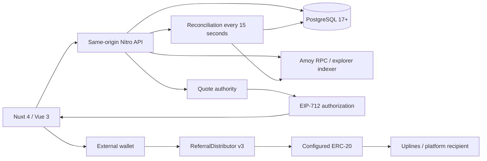

# คู่มือระบบ UNXO

กติกาผังและการจ่ายเวอร์ชัน 3: [แมทริกซ์ ยูนิเลเวล และอัปเกรดอัตโนมัติ](matrix-payments.md)

[สารบัญเอกสาร](../README.md) · [English](../en/system-guide.md) · [การจ่ายเงินและเงื่อนไข](payments-and-conditions.md) · [คู่มือปฏิบัติการ](operations.md) · [API](api-reference.md)

ตรวจสอบซอร์สโค้ดวันที่ **28 ตุลาคม 2026** revision `614d7cd` เอกสารนี้อธิบายความสามารถเวอร์ชัน 3 ใน repository การปรับเอกสารครั้งนี้ไม่ได้ตรวจรับรองยอดเงินจริง การตั้งค่า หรือความพร้อมของระบบที่ deploy อยู่

## 1. วัตถุประสงค์และขอบเขต

UNXO เป็นระบบบริหารเครือข่ายแนะนำสมาชิก มีบัญชีสมาชิก เครือข่ายผู้แนะนำ สิทธิ์แบบซื้อ 15 เลเวล (Level) กระเป๋า EVM การแบ่งค่าคอมมิชชันอัตโนมัติ ข้อมูลกิจกรรมสาธารณะ และพื้นที่ผู้ดูแล รองรับภาษาไทย/อังกฤษและธีมสว่าง/มืด

ค่าเริ่มต้นใช้กระเป๋าภายนอกบน **Polygon Amoy testnet (80002)** สคริปต์ deploy ที่ให้มาสร้าง **UNXO Test USDT (`tUSDT`)** ซึ่งเป็นโทเคนทดสอบและไม่มีมูลค่าเป็นเงินจริง การใช้คำว่า “USDT” ในหน้าจอหรือเครดิตเดิมไม่ได้หมายความว่าเชื่อมต่อกับ USDT จริง ดอลลาร์ หรือบริการแลกเป็นเงินสด

ข้อมูลที่เกี่ยวข้องกับเงินมี 3 ส่วนแยกกัน:

| ข้อมูล | แหล่งอ้างอิงหลัก | ความหมาย |
| --- | --- | --- |
| ยอด POL และ ERC-20 ที่ตั้งค่าไว้ | Blockchain RPC | สินทรัพย์ที่อยู่ในที่อยู่ EVM ปัจจุบันของบัญชี |
| ค่าคอมมิชชันจากสัญญาที่ตรวจยืนยันแล้ว | Receipt ที่ตรวจสอบแล้วและบัญชีใน PostgreSQL | โทเคนที่จ่ายบนเชนไปแล้ว |
| เครดิตและยอดค้างจ่ายภายในเดิม | Ledger ใน PostgreSQL | รายการบัญชีของแอป ไม่ใช่โทเคนที่อยู่ในที่อยู่ EVM |

การผูกกระเป๋าไม่ย้ายสินทรัพย์เก่าและไม่แปลงเครดิตเป็นโทเคน รายละเอียดราคาและการแบ่งจ่ายอยู่ใน[คู่มือการจ่ายเงิน](payments-and-conditions.md)

## 2. สถาปัตยกรรม

API ตรวจบัญชี หาเครือข่ายผู้แนะนำ และกำหนดผู้มีสิทธิ์รับเงิน จากนั้น quote authority ลงนามรับรองข้อมูล ผู้ซื้อใช้กระเป๋าของตนลงนามและส่งธุรกรรม สัญญากำหนดราคาและสัดส่วนตายตัว พร้อมโอนทุกส่วนของการซื้อในธุรกรรมเดียว Worker ตรวจ receipt ก่อนเปิดใช้รหัสแนะนำและบันทึกค่าคอมมิชชัน

| ส่วนใน repository | หน้าที่ |
| --- | --- |
| `app/pages`, `app/layouts`, `app/middleware` | หน้าเว็บ การนำทาง และการแสดงผลสมาชิก/สาธารณะ/ผู้ดูแล |
| `app/components` | กระเป๋า การซื้อ ผังเครือข่าย Explorer แบบฟอร์ม และส่วนควบคุมร่วม |
| `app/composables`, `app/plugins` | Session การเชื่อมผู้ให้บริการกระเป๋า ข้อมูลสรุป ค่าที่ผู้ใช้เลือก และการรีเฟรช |
| `shared` | Types ราคา สูตรแบ่งจ่าย รหัสสมาชิก และการจัดผัง |
| `server/api` | HTTP endpoints และการตรวจสิทธิ์ |
| `server/utils`, `server/lib` | Auth, ledger, ฐานข้อมูล, EVM, การยืนยันการซื้อ และกู้สถานะ |
| `server/plugins` | Migration ตอนเริ่มระบบและการตรวจธุรกรรมเบื้องหลัง |
| `database/migrations` | การเปลี่ยน schema/ข้อมูล PostgreSQL ตามลำดับ |
| `contracts` | สัญญาแบ่งจ่าย โทเคน Amoy และสัญญาทดสอบ |
| `scripts` | ฐานข้อมูลในเครื่อง สร้างผู้ดูแล เครื่องมือสัญญา และตัวรันทดสอบ |
| `tests` | Unit, integration, ฐานข้อมูล สัญญา และ browser tests |
| `i18n`, `app/assets/css`, `public`, `design` | คำแปล รูปแบบหน้าจอ ภาพที่รวมมากับแอป และบันทึกงานออกแบบ |

เทคโนโลยีหลักคือ Nuxt/Vue, PostgreSQL ผ่าน `pg`, Ethers และ Viem คอมไพล์ Solidity ด้วย `solc` ที่ติดตั้งในโปรเจกต์และใช้ OpenZeppelin ต้องใช้ Node **24 ขึ้นไป**

## 3. บทบาทและสิทธิ์

| บทบาท | การเข้าถึงและอำนาจ |
| --- | --- |
| ผู้เยี่ยมชม | หน้าสาธารณะ ตัวอย่าง workspace ค้นหาสมาชิกด้วย ID ธุรกรรมแพลตฟอร์มที่บันทึกไว้ และสถิติรวม |
| สมาชิกที่ active | บัญชีและกระเป๋าของตน ผู้แนะนำ การซื้อ การส่งสินทรัพย์ และสาขาเครือข่ายส่วนตัวที่มีสิทธิ์ |
| ผู้ดูแล | Login ด้วย ID สมาชิกและรหัสผ่าน จัดการสมาชิก ตั้งค่าการเปิดบริการ รายงาน และ API ตรวจรับชำระของระบบเดิม |
| เจ้าของ Smart Contract | เปลี่ยนผู้รับค่าธรรมเนียม/ผู้ลงนาม quote หยุด/เปิดสัญญา และโอนเจ้าของแบบสองขั้นตอน |
| Quote authority | ลงนามรับรองสิทธิ์ สายผู้แนะนำ และเลเวล (Level) เดิม ไม่สามารถลงนามธุรกรรมแทนผู้ซื้อ |
| ผู้รับค่าธรรมเนียม | รับส่วนแพลตฟอร์มพื้นฐานและส่วนที่เปลี่ยนผู้รับตามกติกา |

ผู้ดูแลระบบไม่ได้เป็นเจ้าของสัญญาโดยอัตโนมัติ การเปลี่ยนผู้รับค่าธรรมเนียมผ่านแอปต้องมีทั้ง session ผู้ดูแล **และ** กระเป๋าที่ผูกไว้ซึ่งเป็น owner ของ distributor ที่ตั้งค่าอยู่ เจ้าของและผู้รับค่าธรรมเนียมเป็นคนละที่อยู่ได้ และกุญแจ deploy แยกจากกุญแจ quote authority

การระงับสมาชิกจะลบ session และปิดการเข้าถึงแอป การเข้าสู่ระบบ และการรับโอนเครดิตภายใน สมาชิกที่ถูกระงับจะไม่เป็นผู้รับใน quote ใหม่ แต่การระงับบัญชีไม่ได้อายัดกระเป๋าบนเชนหรือเพิกถอน quote ที่ออกไปแล้วโดยตัวมันเอง

## 4. หน้าจอและการนำทาง

| เส้นทาง | การทำงาน |
| --- | --- |
| `/` | หน้าแนะนำระบบ คำอธิบาย และเครื่องคำนวณเลเวล (Level) แบบตัวอย่าง |
| `/dashboard` | ภาพรวม ค่าคอมมิชชันที่บันทึกไว้ สรุปเครือข่าย กระเป๋า EVM และรายการส่งล่าสุด ผู้เยี่ยมชมเห็นตัวอย่าง |
| `/referrals` (`/referral`) | ผูกผู้แนะนำ เปิดรหัสแนะนำ/ซื้อเลเวล (Level) ถัดไป ดูแบบผังหรือรายการ และส่งออก CSV |
| `/wallet` | กระเป๋าภายนอก/embedded ยอดคงเหลือ Send รายละเอียดและประวัติจาก indexer |
| `/explorer` | ธุรกรรมสัญญาที่บันทึกไว้และการสำรวจเครือข่ายตามสิทธิ์ |
| `/search?id=1` (`/tree`) | ค้นหาผังสายผู้แนะนำสาธารณะด้วยรหัสสมาชิกตัวเลข |
| `/faq` | คำถามที่พบบ่อย |
| `/faq/ranks` | ราคา 15 เลเวล (Level) อัตราแบ่งจ่าย และตัวอย่างประมาณการ |
| `/faq/analytics` (`/analytics`) | สถิติบัญชีและกิจกรรมสัญญาที่ตรวจยืนยันแล้ว |
| `/dashboard?view=settings` | ID สมาชิกแบบอ่านอย่างเดียว ภาษา ธีม กระเป๋า รหัสเชิญ ผู้แนะนำ และ session |
| `/admin/login` | เข้าสู่ระบบผู้ดูแลด้วยข้อมูลบัญชี |
| `/admin`, `/admin/dashboard` | ทางเข้า/ภาพรวมผู้ดูแล การเติบโตของบัญชี และบันทึกกิจกรรม |
| `/admin/users` | ค้นหาด้วย ID กรอง แบ่งหน้า ดูรายละเอียด และระงับ/คืนสถานะสมาชิก |
| `/admin/explorer` | ธุรกรรมแพลตฟอร์มและสำรวจเครือข่ายแบบผู้ดูแล |
| `/admin/settings` | เปิดรับสมัคร/คำขอเติมเครดิต อีเมลช่วยเหลือ สถานะสัญญา และจัดการผู้รับค่าธรรมเนียม |

`/admin/payments` และ `/admin/payment` ส่งต่อไปหน้า dashboard ผู้ดูแล หน้าตรวจชำระเงินเดิมไม่ได้อยู่ในเมนูปัจจุบัน แต่ API ยังอยู่ ลิงก์เก่า `/dashboard?view=wallet`, `ranks`, `rewards`, `faq`, `analytics`, `matrix` จะส่งต่อไปหน้าปัจจุบัน โดย `matrix` ไปภาพรวม

## 5. วงจรบัญชีผู้ใช้

### เข้าสู่ระบบด้วยกระเป๋า ซึ่งเป็นค่าเริ่มต้น

1. เลือก MetaMask, Rabby หรือ Phantom ผ่าน injected provider/EIP-6963 ใช้ส่วนขยายหรือ browser ภายในกระเป๋า ไม่มี QR เชื่อม desktop ไปมือถือแยกเครื่อง Phantom ต้องเปิดรองรับ testnet สำหรับ Amoy
2. Server ออกข้อความใช้ครั้งเดียวอายุ **5 นาที** มี origin ที่อยู่กระเป๋า chain ID nonce และเวลาหมดอายุ
3. ผู้ใช้ลงนาม Server ตรวจผู้ลงนามและบันทึกการใช้ challenge แบบ atomic
4. กระเป๋าใหม่จะสร้างบัญชีสมาชิก รหัสตัวเลข ที่อยู่กระเป๋าที่ผูก และ ledger wallet ยอดศูนย์ บัญชีนี้ไม่มีรหัสผ่านที่ใช้เข้าสู่ระบบได้และไม่ได้สร้าง private key แบบ embedded ใหม่
5. รหัสเชิญที่ใช้ได้จะกำหนดผู้แนะนำ การสร้างสมาชิกใหม่อยู่ภายใต้ `registrationOpen`
6. Server สร้าง session การลงนามเข้าสู่ระบบเป็นคนละขั้นตอนกับ approve โทเคนและซื้อเลเวล (Level)

ระบบ production ต้องตั้ง `NUXT_PUBLIC_APP_URL` เป็น origin ที่ตรงกับแอป รองรับลายเซ็น EOA ยังไม่มี login ด้วย contract wallet แบบ EIP-1271 ผู้ดูแลใช้ `/admin/login` แม้ผูกกระเป๋าแล้ว

### บัญชีเดิมและการผูกกระเป๋า

ค่าเริ่มต้นซ่อนและปฏิเสธ member password login หากเปิด `NUXT_PUBLIC_PASSWORD_LOGIN_ENABLED=true` ชั่วคราว บัญชีเดิมสามารถเข้าสู่ระบบด้วยข้อมูลเดิมแล้วลงนามเพื่อผูกกระเป๋าภายนอก โดยคง UUID ผู้แนะนำ การเปิดสิทธิ์ เลเวล (Level) ที่ซื้อ และประวัติไว้

ที่อยู่กระเป๋าหนึ่งผูกได้กับบัญชีเดียว และ public API ไม่อนุญาตให้เปลี่ยนเป็นที่อยู่อื่น สมาชิกใน external mode ที่ผูกแล้วใช้ wallet login ส่วนผู้ดูแลใช้ ID สมาชิกและรหัสผ่าน กุญแจ embedded และเครดิตเก่ายังคงอยู่ในฐานข้อมูล การผูกกระเป๋าไม่ย้ายสินทรัพย์ให้

การสมัคร embedded ต้องเปิดทั้ง `walletMode=embedded` และ password login ผู้ใช้ตั้งรหัสผ่าน 12–128 ตัว ระบบสร้าง ID สมาชิกตัวเลข ledger wallet และ Amoy wallet ที่เข้ารหัสใน transaction เดียว บัญชีเดิมเข้าสู่ระบบด้วย ID เดิมกับรหัสผ่าน สมาชิกและผู้ดูแลแก้ ID ไม่ได้ และ API ไม่ส่งชื่อผู้ใช้ ดู[รายละเอียดการเปลี่ยนมาใช้ ID](../member-id-update.md)

### Session และการป้องกัน

- Cookie `loop_session` เป็น HttpOnly, SameSite=Strict อายุ 7 วัน และเพิ่ม Secure เมื่อใช้ HTTPS ฐานข้อมูลเก็บเฉพาะ SHA-256 hash ของ token
- Logout ยกเลิก session ปัจจุบัน การระงับบัญชียกเลิก session ของบัญชีนั้น
- POST/PUT/PATCH ต้องมี `Origin` ตรงกับแอป Endpoint ที่ต้อง login ใช้เจ้าของข้อมูลจาก session
- Authentication และรายการการเงินจำกัดจำนวนครั้งตาม scope/IP ในช่วง 15 นาที และ API ใช้ `Cache-Control: no-store`
- เก็บรหัสผ่านด้วย salted scrypt ยังไม่มีลืมรหัสผ่าน เปลี่ยนรหัสผ่าน หรือ MFA

## 6. ผู้แนะนำและผังเครือข่าย

ทุกบัญชีมี `memberId` เป็นตัวเลข เริ่มจาก `1` หลัง activation จึงใช้เลขเดียวกันเป็น `referralCode` ก่อนหน้านั้น `referralCode` เป็น `null` UUID ภายในเป็นคนละค่า รหัส `UNXO-XXXXXXXX` เก่าคงใช้เป็น alias ได้ และ `LOOP-` จะปรับเป็น `UNXO-`

`?ref=` ใช้เติมรหัสในหน้าลงชื่อเข้าใช้ได้จากทุกหน้า Browser tab จำรหัสล่าสุดที่รูปแบบถูกต้อง แต่ server ยังตรวจสิทธิ์ผู้แนะนำอีกครั้ง ผู้แนะนำต้อง activated และ active สมาชิกที่ยังไม่มีผู้แนะนำผูกเพิ่มภายหลังได้โดยไม่มีค่าผูก ไม่สามารถเปลี่ยนผู้แนะนำที่ผูกแล้ว ห้ามแนะนำตนเองและห้ามวงจร หากมีการซื้อค้างอยู่จะผูกเพิ่มไม่ได้จนกว่ารายการนั้นจบ

ผังสมาชิกและผังสาธารณะใช้ **การจัดวางไบนารี** ช่องละ 2 สาขา สมาชิกที่เชิญเพิ่มลงช่องว่างต่อใต้สมาชิกเดิม แต่ยังเก็บผู้เชิญจริงใน `users.sponsor_id` แมทริกซ์แสดงลูก 3 ขั้น รวมเจ้าของเป็น 4 แถว เลือกเลเวลที่ซื้อและรอบได้ ยูนิเลเวลต่อเนื่อง 15 ขั้น Path ใช้เฉพาะ `0` กับ `1` คั่นด้วย `/` เช่น `0/1/0` API เริ่มต้นหน้าต่างยูนิเลเวล 3 ขั้น ส่วนหน้าจอเริ่มที่แมทริกซ์

`referral_placements` เก็บผังยูนิเลเวลต่อเนื่อง Migration 0013 เพิ่ม `matrix_slots` แยกตามเลเวลและ `matrix_auto_upgrades` เป็นคิวถาวร แมทริกซ์จ่ายตาม parent ของช่อง 3 ขั้น ยูนิเลเวลจ่ายตามตำแหน่ง 15 ขั้นเริ่มจาก parent ผู้รับต้องปลดล็อกเลเวลที่ซื้อแล้ว แมทริกซ์ชำระครบ 2/4/8 เปิดช่องเดิมรอบใหม่และเข้าคิวหักราคาเลเวลถัดไปเต็มจากกระเป๋า หากเงินหรือวงเงินไม่พอให้รอ Authority รับรองรอบและใช้ test POL ส่งรายการอัปเกรด

รายการเครือข่ายส่วนตัวและ private explorer แสดงได้ไม่เกิน 15 รุ่น ส่งกลับสูงสุด 500 คน พร้อม `truncated` จำนวนแนะนำตรงแยกนับต่างหาก ผังสาธารณะเปิดเผยเฉพาะ ID ตัวเลข ความสัมพันธ์ parent และ path ไม่เปิดชื่อ UUID ภายใน ข้อมูลเข้าสู่ระบบ ยอดเงิน ที่อยู่กระเป๋า หรือสถานะบัญชี การค้นหา ID ที่มีอยู่ไม่ต้อง login หรือ activated ก่อน

## 7. กระเป๋า รายงาน และหน้าตาแอป

Wallet card กับเมนูโปรไฟล์ใช้ที่อยู่ EVM เดียวกันและแชร์ยอดที่อ่านไว้ 30 วินาที กดรีเฟรชกระเป๋าจะอัปเดตทั้งคู่ ยอดหลักรองรับ USDT และ tUSDT Amoy ที่ตั้งค่าไว้ หากไม่มีโทเคน โทเคนไม่รองรับ หรืออ่านไม่ได้จะแสดงว่าไม่พร้อม ส่วน balance API อ่าน symbol/decimals จริงของ ERC-20 ที่ตั้งค่าไว้ได้

ประวัติกระเป๋ารวมรายการ native และ ERC-20 จาก indexer สูงสุด 50 รายการ ต้องมี explorer API key ที่เข้าถึง Amoy ได้ และข้อมูลอาจตามหลังเชน ส่วนนี้แยกจากรายการส่ง/operation ในแอปล่าสุด 20 รายการและจากประวัติเครดิตภายใน ถ้าไม่มี key จะขึ้นว่าไม่พร้อม ไม่สร้างรายการตัวอย่างแทน

ยอดคอมมิชชัน dashboard รวมเครดิตคอมมิชชันเดิมที่ completed และรายการ on-chain ที่ตรวจแล้ว โดยไม่เพิ่มเครดิต ledger ซ้ำ ค่าคอมมิชชันสะสมอาจไม่เท่ากับยอดโทเคนปัจจุบันหลังโอนออก Public Explorer แสดง hash การซื้อและเปลี่ยนค่าธรรมเนียมที่ฐานข้อมูลบันทึกไว้สำหรับ distributor ปัจจุบัน หน้าละ 12 รายการ ธุรกรรมที่ส่งตรงนอกแพลตฟอร์มต้องมี indexer เพิ่มจึงจะปรากฏที่นี่

Analytics แสดงบัญชีทั้งหมด สมาชิก active ที่ไม่ใช่ผู้ดูแล ผู้ซื้อ/การซื้อที่ยืนยันแล้ว ปริมาณและการแบ่งจ่าย กิจกรรม 30 วันตาม Asia/Bangkok และครบ 15 เลเวล (Level) โดยกรองสัญญาปัจจุบัน ส่วนยอด contract status ของผู้ดูแลอาจรวมสัญญาที่เคยบันทึกทั้งหมด ต้องแยกขอบเขตเมื่อเปลี่ยน distributor กราฟการเติบโตใน admin overview ใช้รายวัน UTC ของรายงานนั้น

ภาษาเริ่มต้นคือไทยโดยไม่อิงภาษา browser เก็บค่าที่เลือกใน `loop_locale` และไม่ใส่ prefix ภาษาใน URL วันที่ภาษาไทยใช้ พ.ศ. ธีมเริ่มต้นมืด เก็บใน `loop-color-mode` รองรับแป้นพิมพ์ การคืน focus หลังปิด modal และ reduced motion ไฟล์ CSV/SVG เป็นการส่งออกจาก browser ไม่ใช่หลักฐานการชำระเงิน

## 8. ขอบเขตที่ยังไม่รองรับ

ตัวเลขประมาณการ rank เป็นภาพประกอบ ด้วยอัตรา 10%/20%/50% ผัง 2/4/8 ที่ชำระครบให้ยอดแมทริกซ์สมมติ `5 × ราคา` ก่อนหักการซื้อเลเวลถัดไปเต็มราคาอีกหนึ่งรายการ ระบบเปิดรอบใหม่และอัปเกรดจาก paid slot จริง คิวถาวร และเงินในกระเป๋า ค่าแสดงผล `firstCycle`/`allocated` เดิมไม่ได้กันค่าคอมมิชชันไว้ สมาชิกตัวอย่างหรือคำว่า “Qualified” ไม่ใช่หลักฐานสิทธิ์ที่ชำระแล้ว

โปรเจกต์ยังไม่มีชำระผ่านธนาคาร/บัตร ถอนเป็นเงินสด แปลงเครดิตเป็นโทเคนผ่าน API สมาชิกรายเดือน KYC รายงานภาษี ระบบคืนเงิน กู้รหัสผ่าน หรือเปลี่ยนกระเป๋าที่ผูก ไม่พบการบังคับหมดอายุ/ต่ออายุเลเวล (Level) ที่ซื้อในโค้ดที่ตรวจ เงื่อนไขที่ต้องให้ผู้ดำเนินการกำหนดเพิ่มเติมอยู่ใน[คู่มือการจ่ายเงิน](payments-and-conditions.md)

## 9. แหล่งอ้างอิงในโค้ด

- [ค่าเริ่มต้นระบบ](../../nuxt.config.ts), [คำสั่งและ dependencies](../../package.json)
- [Member workspace](../../app/components/MemberWorkspace.vue), [ค้นหาสาธารณะ](../../app/pages/search.vue)
- [Authentication](../../server/utils/auth.ts), [ตรวจลายเซ็นกระเป๋า](../../server/api/auth/wallet/verify.post.ts), [ตรวจโหมด](../../server/utils/wallet-mode.ts)
- [ผังสาธารณะ](../../server/api/referrals/tree.get.ts), [ผูกผู้แนะนำ](../../server/api/referrals/sponsor.post.ts)
- [Dashboard](../../server/api/dashboard.get.ts), [รายงานแพลตฟอร์ม](../../server/utils/platform-activity.ts), [สูตรภาพประกอบ](../../shared/plan.ts)
